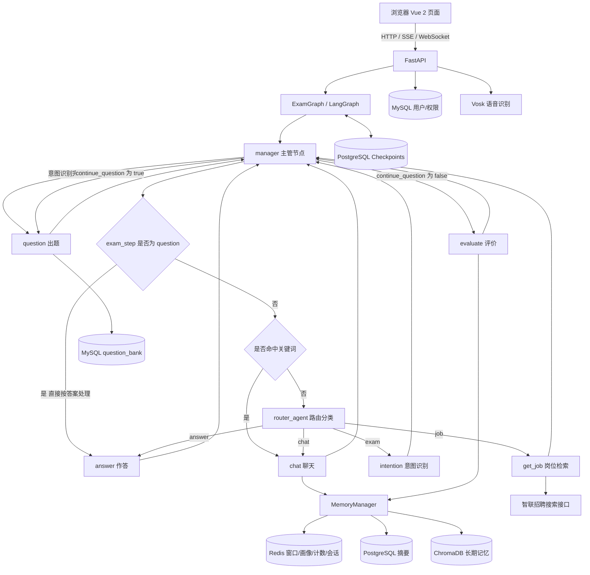

# 模拟面试 + 招聘信息获取

---

## 一、需求完成情况（原始清单）

* 核心聊天功能：
  - [x] 常规聊天，考虑在业务聊天中插入常规聊天但可以保存状态不会被打断
  - [x] 业务聊天：根据用户需求决定爬取就业信息与否以及是否出面试题
  - [x] 意图分析
  - [x] 路由分类
  - [x] 会话管理
  - [x] 记忆管理：
    - [x] 窗口记忆
    - [x] 长期记忆
    - [x] 记忆摘要
    - [x] 用户画像记忆，也就是跨对话记忆
  - [x] 权限设置
  - [x] 优化聊天，做到尽全力低延迟
  - [x] 流式输出
  - [x] 登录注册 + JWT 鉴权

### 原始备注

- 会话锁研究：通过session_id的唯一性来防止多个客户端在同一个会话同时提问，原理是在redis中设置session_id的键对应一个唯一标识，每当进入chat方法，也就是有发送消息的需求时，就会调用该方法，在redis中设置这个键值对，若设置失败，说明此刻正好有其他对话正在发生，该行为就会被阻止，但是会话锁有个问题，就是智能体回复过程中切换对话，对话被打断，此时锁还在redis里，60秒才过期，而我们回到对话重新对话会被自己的锁卡住，所以添加了request库的is_disconnected的api，可以实时检查客户端是否断开连接，从而灵活控制是否释放锁
- 爬数据研究：通过request库伪装成浏览器对网页发送的请求，来get需要的页面的内容，再通过json数据转换以及正则表达式将数据格式化
- 几个智能体介绍：
  * 路由智能体：分析用户输入问题意图，通过输出特定标识来决定决定下一步走向，例如，输出exam,chat,job来标识
  * 模拟面试智能体：根据用户要求，自己编写sql语句并执行来取得想要的数据
  * 意图识别智能体：为模拟面试智能体服务，旨在根据用户输入的问题推断用户需要哪个方向的题目，需要多少
  * 评估智能体：根据用户给题目的答案参照标准答案打分以及评估和建议优化方向
  * 工作岗位推荐智能体：可以按需推荐岗位，也可以根据用户画像推荐相应的岗位
  * 用户画像智能体：根据用户对话内容总结用户画像
  * 记忆摘要智能体
  * 工作岗位参数提取智能体(与意图识别智能体一致)
- 工作流依靠exam_step来标识状态：exam——step表示当前状态，从而决定下一步怎么走
- 记忆消息怎么互通：
  * 窗口记忆：redis，键名：{user_id}: {session_id}，值：{}里装着的对话记录
  * 长期记忆：chromadb，document装着每条单独的消息，metadata：user_id，session_id，save_time
  * 摘要记忆：postgresql，user_id = 3，session_id = session275e...
    summary = "用户具备一定的编程基础，求职方向为人工智能工程师……"
  * 画像记忆：redis，profile对应一整段文本，即用户画像
  * 几种记忆以各自的方式存储，取出时调整数据形式为[{}]，拼接起来传给chat
- get_stream_writer：将工作流的状态自定义输出，可以根据工作流不同状态遇到不同问题时输出自定义的提示并返回给前端
- chat函数：图内部执行入口为manager，负责精细控制整个图的流程，chat为图的外部执行入口，负责接收question以及用户信息并验证，创建会话，上会话锁，同时开始整个问答流程，并流式输出结果，chat_router的chat负责将流式的结果包装成SSE协议并在结尾加结束标识符，同时也负责作为一个入口来收集记忆，在chat方法中设置一个collected来收集每一轮的聊天记录，一轮对话走到end，就开始分别存入各自的记忆系统
- graph的精髓：有状态工作流 + 循环与边，状态原理：通过类来实现状态合并，本项目的messages就是在一个路由分支的工作流中，每一个对话都会被保存起来，同时每一个被该状态需要的参数也可以通过状态池保存下来，供下一个工作状态使用，但是放在类里的状态一旦服务器重启就会清空当前状态，checkpoint=postgresql的作用就是帮助持久化存储状态，即使重启服务也不会影响
- 优化问题：lifespan提前挂载一些重要的模型和加载耗时的东西，如语音加载模型等等
- websocket应用：建立长连接，不再需要多次等待请求和响应，而是传输的数据通过独立的RFC协议标准协议做到客户端和服务端同时，独立的持续传输消息，相较于sse，更适用于适用于**高频、低延迟、双向交互**场景
- 问题：模型降级，本地模型太笨了，即使如果没有降级极容易理解不了提示词导致回复出问题

---

## 二、项目概述


本项目是一个面向求职场景的 **AI 模拟面试 + 就业信息获取** 系统。用户可以通过自然语言完成三类事情：

1. **常规聊天**：日常问答、职业咨询、上下文追问；
2. **模拟面试**：说出目标方向或岗位后，系统按“意图识别 → 出题 → 作答 → 评价”的流程组织一场多轮面试；
3. **岗位检索**：提出求职需求后，系统调用招聘信息工具，返回岗位名称、公司、薪资、城市等信息。

在此基础上，系统还提供：

- 多轮会话与历史记录管理
- 四层记忆架构（窗口记忆、长期记忆、摘要、用户画像）
- SSE 流式输出
- 浏览器语音输入
- 登录注册、JWT 鉴权、管理员用户管理
- 管理员只读查看用户画像

设计上强调三点：

- **有状态**：一场面试可以跨请求、跨重启继续；
- **可降级**：本地模型失败切远程模型，某层记忆失败不影响聊天；
- **可解释**：路由、出题、评价、记忆各有明确职责，便于排查和扩展。

---

## 三、技术概览

### 3.1 总体架构



> 路由分类说明：主管节点先判断当前是否处于“已出题、等待作答”状态；如果是，用户输入直接按答案处理，不再调用路由模型。其它情况下先做关键词兜底，未命中再交给 `router_agent` 分类为 `exam`、`answer`、`chat`、`job` 四类，分别进入意图识别、答题、聊天、岗位检索节点。

整体是一个 **FastAPI 服务 + LangGraph 有状态工作流 + 多存储分层** 的结构：

- FastAPI 负责页面、聊天、历史、画像、管理、语音等接口；
- LangGraph 负责多智能体节点编排和状态流转；
- Redis / MySQL / PostgreSQL / ChromaDB 分别承担不同生命周期和不同粒度的数据；
- 前端是无需构建的 Vue 2 单页页面，通过 SSE 和 WebSocket 与服务端通信。

### 3.2 技术栈

| 层次 | 技术 | 主要用途 |
|---|---|---|
| Web 框架 | FastAPI、Uvicorn | 提供 HTTP / SSE / WebSocket 接口，挂载静态页面 |
| 工作流 | LangGraph | 多节点状态图、条件路由、检查点持久化 |
| 智能体 | LangChain、create_agent | 路由、意图识别、聊天、评价、岗位检索工具调用 |
| 工具封装 | StructuredTool、Pydantic | 把爬虫封装成模型可调用工具，并校验参数 |
| 本地模型 | Ollama + `qwen2.5:7b` | 默认聊天、路由、出题/评价等模型调用 |
| 远程模型 | DashScope 兼容接口 + `qwen3.7-flash` | 本地模型失败时的兜底 |
| 向量模型 | `paraphrase-multilingual-MiniLM-L12-v2` | ChromaDB 文本向量化与语义召回 |
| 关系数据库 | MySQL + PyMySQL | 用户、注册暂存、权限、题库 |
| 缓存数据库 | Redis | 会话、窗口记忆、画像、轮次计数、会话锁、登录 token |
| 向量数据库 | ChromaDB | 长期记忆存储与语义检索 |
| 检查点数据库 | PostgreSQL + psycopg | LangGraph 状态检查点、会话摘要 |
| 前端 | Vue 2（CDN）、marked、fetch、EventSource、WebSocket、Web Audio API | 登录、聊天、流式渲染、语音输入、管理面板 |
| 爬虫 | requests、json、re | 智联招聘 JSON 接口、牛客 HTML 页面 |
| 认证 | JWT（python-jose，HS256） | 登录态、角色鉴权 |
| 语音 | Vosk、Web Audio API | 浏览器采集音频、服务端离线识别 |

### 3.3 模块划分

| 模块 | 位置 | 职责 |
|---|---|---|
| 应用入口 | `app/main.py` | 启动生命周期、初始化连接、注册路由 |
| 聊天/会话路由 | `app/web/chat_router/chat_router.py` | 会话创建、SSE 聊天、历史、画像、语音 WebSocket |
| 系统路由 | `app/web/system_router/` | 登录、注册、验证码、管理员接口 |
| 工作流图 | `app/ai/agent/multi_agent/graph/exam_graph.py` | LangGraph 构图、流式输出、会话锁、记忆写入 |
| 节点 | `app/ai/agent/multi_agent/node/` | 主管、意图、出题、答题、评价、聊天、岗位 |
| 记忆 | `app/ai/agent/multi_agent/memory/` | 四层记忆的存、取、召回、摘要、画像 |
| 工具 | `app/ai/tools/` | 岗位检索工具、参数与记录 Schema |
| 题库爬虫 | `app/data/nowcoder_get.py` | 牛客复习题抓取、解析、去重、入库 |
| 前端 | `app/html/` | 登录页、聊天页（含画像与管理面板） |

### 3.4 数据存储分工

| 存储 | 数据 | 特点 |
|---|---|---|
| MySQL `user_info` | 用户账号、邮箱、密码哈希 | 登录主表 |
| MySQL `register_info` | 注册暂存、验证码流程 | `id` 为本表主键，`user_id` 注册成功后回填 |
| MySQL `permission_info` | 用户名、角色 | `user_id` 为主键，角色为 `user` / `admin` |
| MySQL `question_bank` | 题目、答案、题型、方向 | 面试出题的数据来源 |
| Redis `session{...}` | 会话归属、创建时间 | 24 小时过期 |
| Redis `session_lock:{sid}` | 会话锁 | SET NX PX，60 秒自动过期 |
| Redis `windows_memory:{uid}:{sid}` | 最近窗口消息 | List，LTRIM 保留最近 N 条 |
| Redis `memory_turn:{uid}:{sid}` | 会话轮次 | 每 5 轮生成一次摘要 |
| Redis `profile:{uid}` | 用户画像 | 一个用户一份完整画像，整份覆盖 |
| Redis `profile_turn:{uid}` | 画像轮次 | 跨会话累计，每 20 轮更新画像 |
| PostgreSQL `conversation_summary` | 会话摘要 | `(user_id, session_id)` 唯一 |
| PostgreSQL `checkpoints` / `checkpoint_blobs` / `checkpoint_writes` | LangGraph 状态 | 支持中断恢复、跨请求续聊 |
| ChromaDB `long_memory` | 全量对话原文、元数据 | 向量检索；metadata 含 `user_id`、`session_id`、`save_time` |

### 3.5 模型与外部服务

- **本地模型**：Ollama 暴露 OpenAI 兼容接口 `http://localhost:11434/v1`，模型 `qwen2.5:7b`；
- **远程模型**：DashScope 兼容接口，模型 `qwen3.7-flash`，用于本地模型异常时的兜底；
- **向量模型**：`paraphrase-multilingual-MiniLM-L12-v2`，用于 ChromaDB 的多语言语义检索；
- **语音模型**：Vosk `vosk-model-cn-0.22`，离线中文识别；
- **岗位数据**：智联招聘 PC 搜索接口；
- **题目数据**：牛客网复习专题页面。

---

## 四、技术详解

### 4.1 应用启动与生命周期

`app/main.py` 的启动流程：

1. **Windows 事件循环兼容处理**
   - psycopg 的异步模式不支持 `ProactorEventLoop`；
   - 在导入其它模块之前设置 `WindowsSelectorEventLoopPolicy`；
   - 同时替换 uvicorn 的 loop factory，确保 `auto` / `asyncio` 都返回 `SelectorEventLoop`；
   - 这是 Windows + psycopg 异步连接池的必需处理。

2. **PostgreSQL 检查点**
   - 创建 `AsyncConnectionPool`；
   - 构造 `AsyncPostgresSaver` 并执行 `setup()`，自动创建 checkpoint 相关表；
   - 每个会话的 `thread_id` 就是 `session_id`，因此多轮状态可以持久化。

3. **Redis**
   - 使用异步 Redis 客户端，供会话、锁和图状态使用；
   - 另一套同步 Redis 客户端供记忆模块使用。

4. **ChromaDB**
   - `PersistentClient` 打开本地持久化目录；
   - 使用 `SentenceTransformerEmbeddingFunction` 加载多语言向量模型；
   - `get_or_create_collection('long_memory')`；
   - 通过 `memory_manager.set_collection()` 注册给图节点，解决“节点里拿不到 FastAPI Request”的问题。

5. **图与路由**
   - 构造 `ExamGraph(memory, redis)`；
   - 注册聊天、历史、画像、语音、系统、默认页等路由；
   - `/static` 挂载前端页面。

### 4.2 LangGraph 多智能体工作流

图中共有 7 个节点：

- `manager`：主管节点，负责路由和状态流转；
- `intention`：意图识别，提取面试方向和题目数量；
- `question`：从 MySQL 题库抽题；
- `answer`：记录用户答案；
- `evaluate`：对整场面试进行评价；
- `chat`：常规聊天 + 记忆上下文；
- `get_job`：岗位检索智能体。

节点之间采用“**静态回边 + 动态跳转**”：

- 每个业务节点执行完都回到 `manager`；
- `manager` 根据当前 `exam_step`、用户输入、路由结果，通过 `Command(goto=...)` 决定下一步；
- 这样既保留了图的固定骨架，又允许按对话内容动态选择分支。

`ExamState` 主要字段：

| 字段 | 作用 |
|---|---|
| `messages` | 对话消息列表（累加） |
| `course` | 面试方向 / 课程名 |
| `total` | 计划题目数量 |
| `question` | 已出的题目列表 |
| `current_index` | 当前题号 |
| `question_id` | 当前题目 ID |
| `user_answer` | 用户答案列表 |
| `sure_answer` | 标准答案列表 |
| `evaluation` | 评价结果 |
| `exam_step` | 当前阶段：`start` / `intention` / `question` / `answer` / `evaluate` / `chat` / `job` / `end` |
| `continue_question` | 是否继续出题 |
| `user_id` / `memory_id` | 记忆隔离维度 |

检查点使用 PostgreSQL 持久化，因此：

- 同一条 `thread_id`（即 `session_id`）可以从上一轮继续；
- 服务重启后，已有多轮状态不会丢；
- 前端刷新页面后，历史会话仍可通过记忆和检查点恢复。

### 4.3 主管节点与路由策略

`manager_node` 是最关键的分流点。

1. **考试进行中（`exam_step == 'question'`）**
   - 只要用户输入非空，就直接进入 `answer` 节点；
   - 原因：路由模型里的 `answer` 标签含义是“让 AI 给出答案/讲解”，而这里用户是在“回答题目”，两者语义不同；
   - 如果此时再跑路由，正常作答容易被误判成 `chat`，所以该状态直接按答案处理。

2. **其它状态**
   - 先做关键词兜底：命中常见寒暄、追问、闲聊关键词时直接走 `chat`；
   - 未命中关键词时调用路由智能体；
   - 路由标签：`exam`、`answer`、`chat`、`job`；
   - 分别进入 `intention`、`answer`、`chat`、`get_job`。

3. **状态机推进**
   - `start` → `intention` → `question` → `answer` → ... → `evaluate` → `end`；
   - `answer` 节点根据 `current_index < total` 决定继续出题还是进入评价；
   - `end` 后清空本次面试的题目、答案和索引，回到 `start`。

这种设计的优点是：

- 路由只负责“这句话想做什么”，不负责“当前考试进行到哪一步”；
- 考试状态由 `exam_step` 和 `ExamState` 显式维护，避免模型猜测状态；
- 关键词兜底减少不必要的模型调用，降低延迟。

### 4.4 意图识别与出题

**意图识别节点**：

- 使用 `create_agent` + `IntentionSchema` 结构化输出；
- 从用户输入中提取：
  - `course`：面试方向 / 课程；
  - `num`：计划题目数量；
- 输出 “意图识别成功，课程名称…” 的消息，并写入 `ExamState`。

**出题节点**：

- 从 MySQL `question_bank` 随机抽一道当前方向、且本次面试还没出过的题；
- 使用的核心 SQL 思路：
  ```sql
  SELECT * FROM question_bank
  WHERE question_subject = ?
    AND question_id NOT IN (已出题目)
  ORDER BY RAND()
  LIMIT 1
  ```
- 题目写入 `question` 和 `sure_answer`，同时返回 “第 N 道题: …” 的消息；
- 题目来源包括牛客复习题爬虫入库的数据。

**答题节点**：

- 读取最后一条用户消息；
- 追加 `{question_id, answer}` 到 `user_answer`；
- 根据 `current_index` 和 `total` 设置 `continue_question`；
- 返回 “答案已记录”，由主管节点决定继续出题还是进入评价。

**评价节点**：

- 汇总问题列表、用户答案列表、标准答案列表；
- 拼上记忆上下文（用户画像、摘要、长期召回、窗口对话）；
- 通过 `get_stream_writer()` 逐字流式输出评价内容；
- 评价结果写入 `ExamState.evaluation`。

### 4.5 四层记忆架构

记忆按“生命周期 + 粒度”分为四层，由 `MemoryManager` 统一门面管理。

#### 1）窗口记忆（Redis）

- Key：`windows_memory:{user_id}:{session_id}`；
- 存储：JSON 形式的 `{role, content}`，使用 Redis List；
- 每次写入后 `LTRIM`，只保留最近 N 条；
- 设置 TTL（默认 1 天），会话过期后自动清理；
- 作用：给当前会话提供最近、最直接的上下文。

#### 2）长期记忆（ChromaDB）

- 每轮对话的每条消息都会写入 `long_memory` 集合；
- 元数据包括：
  - `user_id`
  - `session_id`
  - `save_time`
- 检索方式：
  - 用当前问题做向量检索；
  - 默认跨会话召回；
  - 拼上下文时排除当前会话，避免和窗口记忆重复；
- 作用：跨会话找回相关历史，例如“上次面试不会的知识点”。

#### 3）摘要记忆（PostgreSQL）

- 表：`conversation_summary`；
- 唯一键：`(user_id, session_id)`；
- 每 5 轮生成一次（`summary_every=5`）；
- 生成方式：已有摘要 + 最近 5 轮对话 → 摘要模型 → 覆盖更新；
- 查询时支持“当前会话优先 + 其它会话补足”的 `query_recent`；
- 作用：用较短文本保留较长对话的关键信息，控制上下文长度。

#### 4）用户画像（Redis）

- Key：`profile:{user_id}`；
- 一个用户只存一份完整画像，整份覆盖；
- 每 20 个用户轮次更新一次（`profile_every=20`，跨会话累计）；
- 更新流程：
  1. 从 ChromaDB 取该用户最近 20 轮对话（40 条消息），按 `save_time` 排序；
  2. 用摘要模型生成这 20 轮的总结；
  3. 把“上一个画像 + 这次总结”交给画像模型；
  4. 生成一份新的完整画像，覆盖旧值；
- 作用：跨会话了解用户的求职方向、技能、薄弱项和表达风格。

#### 记忆隔离

所有记忆键都同时包含 `user_id` 和 `session_id`（画像除外，它是用户级）：

- 不会取到别人的记忆；
- 不会把 A 会话的摘要写到 B 会话；
- `MemoryManager` 在参数为空时会直接拒绝执行，避免“空 user_id 导致所有人共用一份记忆”。

### 4.6 上下文组装策略

聊天和评价前，通过 `MemoryManager.get_context()` 统一组装记忆上下文，默认配额为：

1. **用户画像**；
2. **最多 2 条摘要**（当前会话优先，其它会话补足）；
3. **2 条向量召回的长期记忆**（默认排除当前会话）；
4. **最近 3 条窗口消息**。

如果整段上下文超过 3000 字符，则自动降级为 **只带 1 条摘要**，其余部分不变。

同时做了两层保护：

- 每一块记忆单独 `try/except`，某一块失败只少一块，不会导致整段上下文消失；
- 长期召回排除当前会话，减少与窗口记忆的重复。

这样既保证了个性化和历史连续性，也避免把本地模型 4096 上下文撑爆。

### 4.7 流式输出

流式输出分为两条链路：

#### 1）聊天 / 评价 / 岗位

- FastAPI 返回 `StreamingResponse`，媒体类型 `text/event-stream`；
- LangGraph 使用 `astream(..., stream_mode=['messages', 'custom'])`：
  - `messages`：模型逐字输出、节点整条消息；
  - `custom`：节点通过 `get_stream_writer()` 主动推送的内容（评价、岗位结果）；
- 只把真正面向用户的节点片段推给前端：
  - `chat`
  - `evaluate`
  - `get_job`
- `manager` 的路由输出、`intention` 的结构化输出属于内部中间结果，不展示给用户；
- 节点自己写的整条消息（“第 N 道题”“答案已记录”等）按 `id` 去重后推送；
- 前端使用 `EventSource` 接收，解析 `data` 字段，用 `marked` 渲染 Markdown。

#### 2）前端等待提示

- 发送消息后，AI 气泡先显示带动画的“正在理解你的问题…”；
- 3 秒后切换为“正在准备面试流程…”，8 秒后切换为“正在生成内容，请稍候…”；
- 收到第一段真正正文后，切换为正常流式内容；
- 第一段如果是 `.`、空白、分隔线等噪声，会被忽略，避免出现“只显示一个点”。

### 4.8 会话管理与并发控制

**会话创建**：

- `POST /create_session`；
- 使用 UUID 生成 `session_id`；
- 在 Redis 中保存 `{user_id, create_time}`，TTL 24 小时；
- 如果请求携带已存在的 `session_id`，会校验归属；
- 前端“开启新对话”时不携带旧 `session_id`，避免后端误判为恢复旧会话，导致侧边栏出现重复 ID。

**会话锁**：

- Key：`session_lock:{session_id}`；
- 使用 `SET key token NX PX 60000` 获取锁；
- 获取失败返回“会话忙，请稍后再试”；
- 释放时使用 Lua 脚本比较 token，保证“只有锁的持有者才能删除”，避免误删；
- 记忆写入放在锁外，避免摘要/画像调模型的几秒钟阻塞同一会话的后续请求。

### 4.9 登录、注册与权限

**注册流程**：

1. 发送邮箱验证码；
2. `register_info` 暂存邮箱；
3. 校验验证码后填写用户名、密码；
4. 写入 `user_info`（密码哈希）；
5. 回填 `register_info.user_id`；
6. 写入 `permission_info`，默认角色 `user`。

**登录流程**：

1. 按邮箱查询 `user_info`；
2. 校验密码哈希；
3. 查询 `permission_info` 获取角色；
4. 生成 JWT，payload 包含：
   - `user_id`
   - `username`
   - `role_name`
   - `exp` / `iat`
5. 返回 `token`、`user_id`、`username`、`role_name`；
6. 前端把 `token` 和 `user_id` 存入 `sessionStorage`。

**权限控制**：

- 管理员接口使用 `has_roles('admin')` 依赖；
- 从 `Authorization: Bearer <token>` 中解析 JWT；
- 校验角色后放行；
- 普通用户访问管理接口返回 403；
- 管理员不能删除自己、不能把自己降级。

### 4.10 管理端功能

管理功能集成在聊天页中，管理员登录后会在顶栏看到“用户管理”入口。

功能包括：

- 用户列表：用户 ID、用户名、邮箱、角色；
- 用户名 / 邮箱搜索；
- 修改用户角色（`user` / `admin`）；
- 删除用户（两次点击确认）；
- 只读查看用户画像。

后端接口：

| 方法 | 路径 | 说明 |
|---|---|---|
| GET | `/admin/users` | 用户列表 |
| GET | `/admin/profiles` | 所有用户画像（只读） |
| GET | `/admin/profile/{user_id}` | 单个用户画像（只读） |
| GET | `/admin/get_user` | 按用户名查用户 |
| PUT | `/admin/change_role` | 修改角色 |
| POST | `/admin/delete_user/{username}` | 删除用户 |

删除用户时会同时清理：

- `user_info`
- `register_info`
- `permission_info`
- Redis 中的画像、轮次、窗口记忆、token、会话记录
- ChromaDB 中的长期记忆
- PostgreSQL 中的摘要和 checkpoint

用户画像没有管理员写接口，前端也只提供 `<pre>` 只读展示，确保管理员只能看、不能改。

### 4.11 岗位信息获取

核心文件：`app/ai/tools/get_job_tool.py`。

技术栈：

- `requests`：HTTP POST；
- `json`：请求与响应序列化；
- `random` / `time`：请求 ID、随机休眠、失败重试；
- `pydantic`：参数和记录校验；
- `StructuredTool`：封装成智能体工具；
- `create_agent`：让模型决定何时调用工具；
- LangGraph `get_stream_writer`：把结果推给前端。

流程：

1. 请求智联招聘内部搜索接口：
   ```text
   https://fe-api.zhaopin.com/c/i/search/positions
   ```
2. 请求体包含关键词、城市代码、页码、每页条数等；
3. 请求头伪装浏览器，并携带客户端 ID、平台标识、每次变化的请求 ID；
4. 单页失败最多重试 3 次，页间随机休眠 1~3 秒；
5. `parse_job()` 把原始数据整理成 14 个字段；
6. `JobSearchParams` 校验关键词、城市代码、页数、筛选字段；
7. `search_jobs` 返回 JSON 字符串（`total`、`returned`、`truncated`、`jobs`）；
8. `get_job_node` 创建 agent，模型从用户话里提取参数并调用工具；
9. 工具结果和模型总结通过 custom 流实时返回前端。

注意：当前岗位结果是 **实时检索并返回**，没有写入 MySQL；MySQL 主要存用户和题库。

### 4.12 牛客题库抓取

核心文件：`app/data/nowcoder_get.py`。

技术栈：

- `requests`：GET 页面；
- `re`：正则提取题目和答案；
- `pymysql`：写入 MySQL；
- `argparse`：命令行参数；
- `random` / `time`：限速和重试。

流程：

1. 访问牛客复习专题页面：
   ```text
   https://www.nowcoder.com/ta/{slug}/review?page={page}
   ```
2. 用正则提取：
   - 题目：`<div class="final-question">...</div>`
   - 答案：`<div class="design-answer-box">...</div>` 到操作按钮之前；
3. 去掉 HTML 标签，压缩空白，保留代码换行；
4. 按 `question_title` 判重，已存在则跳过，支持断点续爬；
5. 参数化 SQL 插入 `question_bank`：
   - `question_title`
   - `answer`
   - `question_type='技术知识'`
   - `question_subject=方向`
6. 面试流程中的 `question_node` 从该表随机抽题。

没有使用 BeautifulSoup / Selenium / Scrapy，结构简单，但页面 DOM 变化时需要同步调整正则。

### 4.13 语音输入

语音采用“浏览器采集 + 服务端识别”的方式，不再由服务器直接打开本机麦克风。

流程：

1. 用户点击语音按钮；
2. 浏览器通过 `navigator.mediaDevices.getUserMedia()` 获取麦克风权限；
3. `AudioContext` + `ScriptProcessorNode` 采集音频；
4. 重采样为 16kHz、单声道、Int16 PCM；
5. 通过 WebSocket `/vosk` 发送二进制音频；
6. 服务端用 Vosk `KaldiRecognizer` 识别；
7. 实时返回：
   - `{"type":"partial","text":"..."}`：识别中的文字；
   - `{"type":"final","text":"..."}`：最终结果；
8. 前端把 partial 填入输入框，收到 final 后自动发送；
9. 中文结果会去掉字间空格，例如：
   `你好 我 想 找 一 份 后 端 开 发 的 工 作` → `你好我想找一份后端开发的工作`。

这样浏览器端负责采集，服务端只负责识别，部署到其它机器时识别的是访问者自己的麦克风。

### 4.14 前端实现

前端没有使用构建工具，直接使用 Vue 2 CDN：

- `login.html`：登录 / 注册 / 验证码；
- `chat.html`：聊天主页面、历史会话、画像、管理面板、语音按钮。

关键点：

- **SSE**：`EventSource` 接收聊天流式数据；
- **WebSocket**：语音 PCM 传输；
- **Markdown**：`marked` 渲染 AI 回复；
- **历史记录**：本地缓存全量历史，输入关键词时实时过滤，不需要每敲一个字都请求后端；
- **管理面板**：仅管理员可见，支持用户列表、角色修改、删除、只读画像；
- **画像**：普通用户可以查看和编辑自己的画像；
- **响应式**：移动端对侧边栏、按钮和弹窗做了适配。

### 4.15 异常处理与降级

- **模型降级**：本地 Ollama 调用失败时切换远程 DashScope 模型；
- **记忆降级**：画像、摘要、窗口、长期召回分别 `try/except`，单块失败不影响整体；
- **管理端降级**：用户画像读取失败时返回空画像，列表仍能展示；
- **会话并发**：获取不到会话锁时返回“会话忙”，避免同一会话并发写乱状态；
- **Windows 兼容**：强制 SelectorEventLoop，解决 psycopg 异步连接池与 Proactor 的冲突；
- **前端提示**：语音权限、连接失败、流式中断等都有明确提示。

### 4.16 关键技术难点与解决

| 难点 | 解决方式 |
|---|---|
| Windows 下 psycopg 异步连接报 Proactor 错误 | 启动时设置 Selector 策略，并替换 uvicorn loop factory |
| ChromaDB 多条件查询报错 | 使用 `$and` 包裹 `user_id` / `session_id` 条件 |
| ChromaDB 类型敏感 | `user_id` / `session_id` 统一存字符串，查询也转字符串 |
| 新建会话后侧边栏重复 ID、历史点不了 | 新建对话不携带旧 `session_id`，并做重复 ID 防御 |
| 答题被路由成 chat | 出题后等待作答时直接进入 answer，不再跑路由 |
| 上下文过长 | 固定配额 + 3000 字符预算，超长时只保留 1 条摘要 |
| 内部路由/意图输出漏到前端 | 只推送 `chat` / `evaluate` / `get_job` 的模型片段 |
| 同一会话并发请求 | Redis SET NX PX 会话锁 + Lua 安全释放 |
| 管理员误改用户画像 | 只提供只读画像接口，前端只读展示 |
| 删除用户后数据残留 | 同时清理 MySQL、Redis、ChromaDB、PostgreSQL |
| 服务端麦克风方案不可部署 | 改为浏览器采集 PCM + WebSocket + Vosk |

### 4.17 可优化方向

1. **爬虫稳定性**
   - 使用异步请求和连接池；
   - 增加代理池、限速策略和失败监控；
   - 牛客页面可改为结构化解析，降低正则对 DOM 变化的敏感性。

2. **可观测性**
   - 增加结构化日志、请求 ID、节点耗时统计；
   - 对模型调用、记忆召回、工具调用分别打点。

3. **接口安全**
   - 业务接口增加 JWT 校验；
   - 管理端增加操作审计；
   - 敏感配置统一从环境变量读取。

4. **记忆优化**
   - 摘要与画像的触发阈值可配置；
   - 增加记忆重要性评分和去重；
   - 对长期记忆按会话/时间做分层召回。

5. **工程化**
   - 增加单元测试和端到端测试；
   - 前端工程化（Vite / 组件化）；
   - 容器化部署和健康检查。

---

## 五、答辩要点

### 5.1 一分钟介绍

> 本项目是一个基于 LangGraph 的 AI 模拟面试与就业信息获取系统。后端使用 FastAPI 提供接口，LangGraph 编排主管、意图、出题、答题、评价、聊天、岗位检索等节点；记忆分为窗口、长期、摘要、画像四层，分别落在 Redis、ChromaDB、PostgreSQL 和 Redis；前端使用 Vue 2 和 SSE 实现流式聊天，并支持浏览器语音输入、历史检索和管理员用户管理。

### 5.2 技术亮点

1. **有状态多智能体工作流**：节点职责清晰，主管节点动态路由，PostgreSQL checkpoint 支持多轮续聊。
2. **四层记忆架构**：不同生命周期、不同粒度的记忆分开存储，兼顾即时上下文、跨会话召回和长期个性化。
3. **上下文预算控制**：固定配额 + 超长降级，避免本地模型上下文溢出。
4. **流式体验**：SSE + LangGraph 流式输出，前端有阶段提示和噪声过滤。
5. **工程细节**：会话锁、Windows 事件循环兼容、Chroma 查询类型处理、重复会话 ID 防御。
6. **完整业务闭环**：登录注册、面试、评价、岗位检索、语音、画像、管理端。

### 5.3 常见答辩问题

**Q1：为什么用 LangGraph，而不是普通链式调用？**

因为面试流程需要状态、条件分支和中断恢复。LangGraph 的 StateGraph、条件边和 checkpointer 正好覆盖这些需求。

**Q2：为什么需要四层记忆？**

窗口记忆负责最近上下文，长期记忆负责跨会话召回，摘要负责压缩长对话，画像负责用户级个性化。四者生命周期和粒度不同，放在一层里会互相干扰。

**Q3：上下文太长怎么办？**

默认只带画像、最多 2 条摘要、2 条长期召回、3 条窗口消息；超过 3000 字符时只保留 1 条摘要。

**Q4：如何保证同一会话不被并发写乱？**

Redis `SET NX PX` 会话锁，释放时用 Lua 比较 token，确保只有锁持有者能删除。

**Q5：管理员能改用户画像吗？**

不能。后端只提供只读画像接口，前端用只读 `<pre>` 展示。

**Q6：岗位信息是怎么获取的？**

调用智联招聘内部 JSON 搜索接口，使用 requests 发 POST，做浏览器头伪装、请求 ID、重试和限速；结果通过 StructuredTool 交给智能体调用。

**Q7：牛客题目是怎么入库的？**

requests 抓 HTML，正则提取题目和答案，按标题去重后参数化写入 MySQL 的 `question_bank`。

**Q8：语音为什么不用服务端麦克风？**

浏览器采集音频再通过 WebSocket 发送，部署到其它机器时识别的是访问者自己的麦克风，适用性更好。

**Q9：项目还有哪些不足？**

单机部署、爬虫对页面结构敏感、业务接口鉴权还可以加强、缺少系统化测试和监控。这些都在后续优化计划中。
